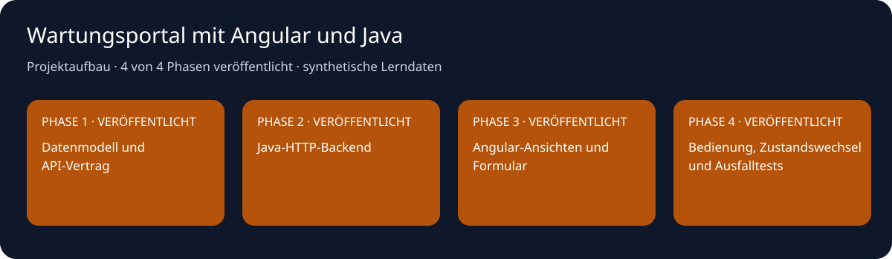

# Wartungsportal mit Angular und Java

Ein Wartungsteam möchte Aufträge anlegen, wiederfinden und ihren Bearbeitungsstand ändern; Eingabefehler und ein nicht erreichbares Backend müssen verständlich bleiben.



**Veröffentlichungsstand: Phase 4/4.** Dieses eigenständige Repository veröffentlicht zuvor lokal entwickelte, geprüfte und unveränderlich gesicherte Stände. Alle vier dokumentierten Basisphasen sind veröffentlicht. Die technische Entwicklung und die öffentliche Veröffentlichung haben unterschiedliche echte Zeitpunkte.

## Was hier zu sehen ist

| Schritt | Inhalt | Hier veröffentlicht |
|---|---|---|
| 1 | Datenmodell und API-Vertrag | Ja |
| 2 | Java-HTTP-Backend | Ja |
| 3 | Angular-Ansichten und Formular | Ja |
| 4 | Bedienung, Zustandswechsel und Ausfalltests | Ja |

## Fachlicher Nutzen

Frontend-/Backend-Verträge, Formularvalidierung, Barrierearmut und HTTP-Fehlerbehandlung.

## Lokal starten

Im geklonten Repository ausführen; die benötigte Laufzeit muss installiert sein. Python-Beispiele verwenden 3.12, Node-Beispiele 24 und C# die im Projekt angegebene .NET-Version. Befehle mit uv laden die dort genau bezeichneten Pakete bei Bedarf.

```powershell
python -X utf8 pruefungen/vertrag_pruefen.py
python -X utf8 pruefungen/api_pruefen.py
npm ci
npm run bauen
```

Ausführliche technische Befehle: [START.md](START.md). [Öffentlicher Prüfstand](ABNAHME.json) und [Quellphasen](VERLAUF.json) dokumentieren Herkunft und echte Ausführungsdaten. Eine neue Repositorykopie ist kein neuer nativer Desktoplauf.

## Ergebnis des lokal geprüften Schlussstands

Drei Ansichten, Auftragsanlage und Zustandswechsel; Tastaturbedienung und API-Ausfall im Browser geprüft.

## Grenzen

Java-HTTP-Backend ohne Spring; keine React-, Vue- oder Figma-Variante.

Eigenes kleines Lernprojekt mit synthetischen Daten, mit KI-Unterstützung entwickelt und geprüft. Keine Aussage über Berufserfahrung, menschliche Arbeitsstunden oder praktische Verwendung weiterer nur geplanter Produkte.

## Entwicklungshistorie

[Entwicklungshistorie](HISTORIE.md): die vorhandenen lokalen Änderungen, ihre ursprünglichen Daten und die spätere GitHub-Übernahme.
